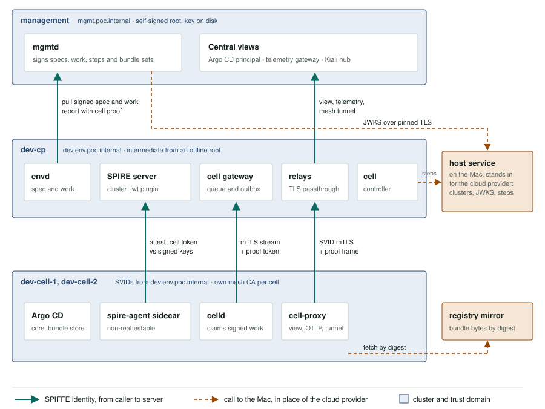

# Retrospective of the PoC, M0 to M9

The PoC asked one question. Can a management plane, an environment control plane and many cells
authenticate to each other with SPIFFE identities, with no credential copied between clusters?
It ran five kind clusters on one Mac, one milestone at a time, and each milestone ended with an
automated gate.

This document records what the PoC learned about SPIFFE and SPIRE, and about the structure of
the components. The last section proposes the next phases.

| Fact | Value |
| --- | --- |
| Span | 2026-11-07 to 2026-11-25 |
| Milestones | M0 to M9 |
| SPIRE | v1.15.5, upstream, with an external plugin |
| Clusters | `management`, `dev-cp`, `dev-cell-1`, `dev-cell-2`, `rogue` |

## Architecture

The management plane decides, the environment control plane executes, and cells serve.
Every connection goes up a layer. The management plane opens no connection into an environment
or a cell.

[`docs/architecture.yaml`](architecture.yaml) holds the same architecture in a form for tools and AI agents.
It lists each cluster, trust domain, SPIFFE ID, connection and flow, with the source of each fact.

Solid arrows carry SPIFFE identities, from the caller to the server.
Dashed arrows go to the Mac, which plays the cloud provider.
The trust domains do not federate. Each plane pins the root of the other plane.
A cell reads the management root from a static file in its bootstrap set.
The `rogue` cluster runs the same clients with no registration.

| Result | Milestone |
| --- | --- |
| `celld` got its first SVID about 8 seconds after start, with a token rooted in its own cluster | M2 |
| Two cells were valid 15 minutes 6 seconds after one portal request | M6 |
| A signed bundle set applied in a cell in 2 to 9 seconds | M8 |
| An island held for 3 hours 15 minutes at SVIDs of 1 hour, and no pod was replaced | M9 |

## Milestones

| Milestone | Merged | What it proved | Key decision | Headline result |
| --- | --- | --- | --- | --- |
| M0 | 2026-11-08 | One base cell template: Argo CD core, Istio, default deny, collector, bundle store | Argo CD applies only hydrated bundles, pinned by digest | All 15 checks pass |
| M1 | 2026-11-08 | Five clusters from clean, each with its own token issuer | The host service is the one path to provision | `rogue` reaches only 5 ports |
| M2 | 2026-11-09 | A cell attests to a remote SPIRE server with its own cluster keys | A custom `cluster_jwt` attestor, because `k8s_psat` needs a kubeconfig for each cell | First SVID in about 8 seconds |
| M3 | 2026-11-13 | A central Argo CD view, telemetry and Kiali, with no credential out of a cell | The read-only guard lives in the cell. Kiali reads through a tunnel that the cell opens | 408 checks pass |
| M4 | 2026-11-13 | Signed specs, and cluster keys checked by a party that did not create the cell | A spec is a signed index of record digests, delivered through a ConfigMap | Records reach the plugin in 50 to 60 seconds |
| M5 | 2026-11-17 | Signed work applies once, and the control plane cannot pose as a cell | A second proof: a cell token whose audience binds the item | 30 operations in 30 minutes, largest claim gap 747 ms |
| M6 | 2026-11-18 | Provisioning from one portal request | Steps travel in the signed spec, and three parties verify each step | Both cells valid in 15 minutes 6 seconds |
| M7 | 2026-11-18 | A rogue cluster, a rogue JWKS and interception at each hop all fail | Three impostor certificates for each hop, checked by reason and by byte count | 13 tests pass |
| M8 | 2026-11-19 | Signed bundle sets reach Argo CD, and a failure rolls back | Bytes move by digest through a shared registry, because a gateway frame holds 60 KiB | Rollback in 20 to 25 seconds |
| M9 | 2026-11-25 | Islands hold for three SVID lifetimes, and revocation works with or without the link | A local revoke signed with a separate operator key. Pods stay, and agent sidecars restart | The gateway refused a revoked cell in 5 to 13 seconds |

## SPIFFE and SPIRE

### Attestation

**Attest a remote cluster against its published keys.**
`k8s_psat` calls TokenReview on the cell, so a central server would need a kubeconfig for each cell.
The `cluster_jwt` plugin checks a projected token against the public keys in a signed cell record.
It never uses the keys that the `iss` claim names.
All 8 rejection cases fail as designed, from `unknown_kid` to `token_replayed`.
In production, one method works across clouds and self-hosted clusters, and SPIRE stays unforked.

**Make agents non-reattestable, with a nonce in the agent ID.**
SPIRE attests a reattestable agent again at each rotation, which fails in an island after a key rotation.
The plugin returns `can_reattest = false`, so a running agent renews with no new token.
With the token RoleBinding removed, an agent renewed twice with no second attestation.
Running workloads keep their identity through a key rotation, and only new pods wait.

**Put a server nonce in the token audience.**
The sidecar asks for a token with the audience `spire-<env>/<nonce>`.
The server makes the nonce inside one attestation stream, so a copied token fails in another stream.
Servers in an HA pair need no shared replay cache.
Any identity that can create a pod as the cell account can still attest as the cell.

**Get cluster keys from an independent source.**
The control plane that creates a cell cannot vouch for its keys.
`mgmtd` reads the JWKS of each cluster from the provider over pinned TLS, and binds the issuer once with a nonce token.
A rogue JWKS fails with `issuer_untrusted`. The binding is trust on first use.
On EKS, the public OIDC issuer JWKS is the source.

**Give cluster key rotation a fast hint path.**
EKS rotates the signing key of each cluster every 7 days.
On `unknown_kid` for a known cell, the plugin raises a hint, and `mgmtd` checks the keys at once.
From the first refusal to an issued SVID took 40 to 112 seconds, mostly the kubelet ConfigMap sync.
Only a proven key update starts the rate-limit gap, so forged hints cannot lock out real updates.

**Plan attestation limits outside the plugin.**
SPIRE gives server plugins no shared store, so each server keeps its in-flight cap and rate budget in memory.
The SPIRE limit for each address is off, because all pods of a cell share the node address.
Failed attestations have no rate limit, and 8 held streams can block the new attestations of a cell.
A limiter before authentication on the node port is the production answer.

### Trust domains and keys

**Pin roots between trust domains, with no federation.**
The management plane and each environment pin the root of each other.
A cell never reads the management root from the Workload API, because the environment server could serve a fake bundle.
A `dev-cp` SVID that poses as the principal fails with `peer_untrusted`.
Renders fetch peer roots live, and `cell:verify` checks them.

**Add a proof that the environment CA cannot make.**
A SPIFFE ID proves that a CA vouches, and not that a cluster made the claim.
Each report from a cell carries a projected cell token whose audience binds the exact item.
A fixed audience was rejected, because `dev-cp` could replay the token with another body.
For each claim, decide which authority vouches for it.

**Use an intermediate from an offline root.**
`dev-cp` loads a 30-day intermediate through `UpstreamAuthority "disk"`, from the secret manager.
Cells pin the root, so a new intermediate is invisible to them.
In production, stage the next intermediate early, and switch at half life.

**Keep a self-signed root on disk, and make its rotation resumable.**
With no upstream, `KeyManager "memory"` makes a new root at each restart and breaks every peer copy.
A root rotation has five steps, and after the revoke step there is no rollback.
A resume of step 5 finishes an interrupted rotation.

**Keep the mesh CA apart from the plane identity.**
Istio does not use SPIRE. The istiod of each cell has its own self-signed CA and trust domain.
Nothing outside the cell trusts that CA, so a mesh CA compromise stays inside one cell.

### Lifetimes, partitions and revocation

**Expect an agent restart in place at SVID expiry.**
An agent whose SVID expires while its server is out of reach exits. No option in v1.15.5 changes this.
In a 3 hour island at SVIDs of 1 hour, agents restarted 155 to 171 times.
`celld` and `cell-proxy` did not restart, and no pod was replaced.
Pod liveness does not depend on the agent, and after a long island every agent of the cell attests at once.

**Cap the back-off of Workload API clients.**
go-spiffe keeps the last SVID and retries, so clients do not exit.
With default back-offs, clients took a new SVID 84 to 135 seconds after their agent returned.
A shared client caps both back-offs at 5 seconds. Clients now take a new SVID about 5 seconds after the agent.

**Build revocation from layers.**
SPIFFE has no revocation. A revoke is a flag in the signed record, or a signed local overlay in an island.
Four points enforce it: the plugin, the gateway, an agent ban and the view proxies.
A ban alone fails, because the banned agent attests again as a new agent within about 1 second.
Short SVIDs bound the exposure of running workloads.

**Expect ConfigMap delivery to dominate the latency.**
`envd` writes the records to a ConfigMap that the server pod mounts, and the plugin reloads every 10 seconds.
A new revision took 50 to 60 seconds to reach the plugin, and a local revoke took 38 to 90 seconds.
A direct path from `envd` to the plugin is the proposed fix, and it is not tested.

**Use short SVIDs for a fast test tier.**
SPIRE sets no floor on SVID lifetimes. It warns above `ca_ttl / 6`, and its CA rotator runs every 10 seconds.
`spire-server validate` does not show these warnings.
The fast tier runs SVIDs of 1 minute. The slow tier runs SVIDs of 1 hour, and takes about 4.5 hours.

## Structure and integration

**Split decide from execute.**
`mgmtd` decides and signs. `dev-cp` executes, but it cannot forge, retarget or repeat work, or pose as a cell.
It can only drop, delay or reorder work.

**Guard the central view inside the cell.**
The Argo CD Agent principal can replace annotations, and its resource proxy forwards writes and exec.
The cell holds the guard: a Role with no write verb, an admission policy and a closed set of Secrets.

**Read cells through a tunnel that the cell opens.**
Kiali reads each cell through a held mTLS tunnel, so no kubeconfig leaves a cell.
One absent cell stops the mesh view for all cells.

**Sign an index of record digests, and keep a revision mark in each reader.**
`envd`, the plugin, the gateway and the cell controller each verify the spec under their own pin.
A new spec field makes older readers refuse the whole spec, so readers roll out before the signer.

**Run work through a gateway with leases and an outbox.**
`celld` replicas compete for work, one stream each. A claim creates an in-cell record with a lease.
Work expires 1 hour after its signature, so a longer island drops queued work.

**Count the cost of ConfigMaps as the internal bus.**
Records, steps, overlays, hints and the cell registry all travel through ConfigMaps, with no new listener in `dev-cp`.
Each writer of such a ConfigMap joins the trust base.

**Carry every cross-cluster stream in one proxy binary.**
`cell-proxy` runs as client, server, token proxy, tunnel and PromQL proxy.
The server owns TLS 1.3, the exact ID check, the registry check and the proof frame.

**Sign bundle sets in DSSE, verify them in the cell, and move bytes by digest.**
`mgmtd` signs each set as an in-toto statement. The cell checks every object with OPA before it moves `root:current`.
Probes of parser parity found two Critical bypasses, where Argo CD applied objects that the policy never saw.
The fix signs a canonical form and refuses every other form.

**Count success only from a finished Argo CD sync at the digest.**
After an admission denial, Argo CD once reported Synced with nothing applied.
The engine waits for each Application to sync at its new digest, and rolls back on failure.

**Reset telemetry source tags from the SPIFFE ID.**
Each collector strips and sets four source attributes.
The central gateway sets them again from the verified ID, and counts each change.

**Treat NetworkPolicy as exposure control, and identity as access control.**
Plane listeners admit cell node addresses, so admission is per node, not per workload.
A new pod has no policy for about 800 ms, and kindnet fails open while its own pod restarts.

**Keep the executor outside the GitOps path that it checks.**
`celld`, `envd` and the gateway sit outside every Argo CD Application.
Kubernetes applies no admission policy to admission policy objects, so the engine refuses changes to the guard.

## Open questions

| Area | Question | Phase |
| --- | --- | --- |
| Trust | Cells do not check approver signatures, so a compromised management plane can sign any work | M10 |
| Trust | The issuer binding is trust on first use. The token key of a cluster is the root of trust for that cell | M11 |
| Trust | Any identity that can create pods in a cell namespace holds the identity of that cell | M12 |
| Trust | A hostile platform bundle has the power of cluster admin. Nothing detects a `root:current` tag moved outside the signed path | M10, M12 |
| Scale | SPIRE HA, a limiter before authentication, and limits on failed attestations are not built | M13 |
| Scale | Key sets, a recovery quorum, root rotation and restore with epochs are not tested | M11 |
| Islands | Revoke latency to the plugin is 26 to 90 seconds, and the relay keeps the streams of a revoked cell | M14 |
| Islands | An island over 1 hour drops queued work. Island signals have no alerts. The queue size for 24 hours is a projection | M14 |
| Cloud | The EKS gate has not run | Not in these phases |

## Next phases

These phases answer the open questions, except the EKS gate. Each phase answers one question and ends with an automated gate.
The scope comes from the phase 2 sections of the target architecture. The gate checks are proposals.

| Phase | Title | Depends on |
| --- | --- | --- |
| M10 | Approvals in the cell | Nothing |
| M11 | Key sets, recovery and restore | M10, because approvers sign key set changes |
| M12 | Least privilege in the cell | Nothing |
| M13 | SPIRE HA and attestation limits | Nothing |
| M14 | Fast revocation and long islands | M11 and M13 |

### M10: Approvals in the cell

The management plane alone can no longer change a cell. `celld` checks approver signatures over the decoded item.

- Scope: an approver directory in each signed record, and an approver CLI that shows the item before it signs.
  The author never approves, and platform bundles need a platform approver.
  Application bundles need a second signature, and platform components get a signed security floor.
  `celld` restores a `root:current` tag that does not match the last signed set.
- Gate: work that only `mgmtd` signs fails with `approval_missing`. A self-approval fails.
  A bundle below the floor fails. A moved tag returns to the signed root.
- Owner decisions: where approver keys live in the PoC, and which kinds need approval.

### M11: Key sets, recovery and restore

Each change to what a component trusts arrives as a signed key set with a version and an epoch.

- Scope: key sets that follow the signer matrix, with no downgrade, applied first on reconnect.
  A recovery quorum of 3 of 5 offline keys. Rotation of the `dev-cp` root, with retirement after each acknowledgement.
  Restore with epochs. More than two new cluster keys between checks needs an approver.
- Gate: a root rotation completes while one cell is in an island. A key set with a lower version fails.
  An old backup of `mgmtd` is refused until the quorum bumps the epoch.
- Owner decisions: how the PoC holds quorum keys, and whether the `management` root joins the key sets.

### M12: Least privilege in the cell

A pod in a cell namespace no longer gets the identity of that cell.

- Scope: admission policies, so only the harness creates pods as the identity service accounts.
  Token requests for those accounts come only from their own pods.
  Platform bundles get an allow-list for ClusterRoleBindings and webhooks.
  Each cluster gets its own access token, and Secrets are encrypted at rest.
- Gate: a pod created as `celld` by another identity fails. `istiod` can no longer run a pod as `celld`.
  An etcd read of `spire-upstream` shows ciphertext.
- Owner decisions: the admission engine, and how far to narrow the platform class.

### M13: SPIRE HA and attestation limits

One server failure or a flood of attestations no longer stops a cell.

- Scope: a second `dev-cp` SPIRE server with the same root and its own intermediate, on a shared datastore.
  A limiter before authentication on the node port. Limits on failed attestations.
  A cap on in-flight slots for each source.
- Gate: stop one server under load, and agents continue through the other.
  A flood from an unregistered pod does not delay a real cell past a set bound.
- Owner decisions: the shared datastore, the limiter, and the flood bound.

### M14: Fast revocation and long islands

A revoke takes effect in seconds at each point, and an island of a day keeps its work and its signals.

- Scope: records reach the plugin directly from `envd`.
  The relay gets outer mTLS and caps for each cell, and closes the streams of a revoked cell.
  Work survives an island over 1 hour, fenced by epoch. Island signals get alert rules.
- Gate: the time from revoke to plugin refusal stays under a set bound, measured directly.
  Work signed before a 24 hour island applies once after the heal.
  The collector queue stays under its cap for 24 hours.
- Owner decisions: the revoke latency target, and the longest island with queued work.

## Sources

The target architecture, the PoC scope and the base cell design in `docs/design/`, the README, and the pull request of each milestone.
A value that this document marks as a bound, a projection or a proposal is not a direct measurement.
